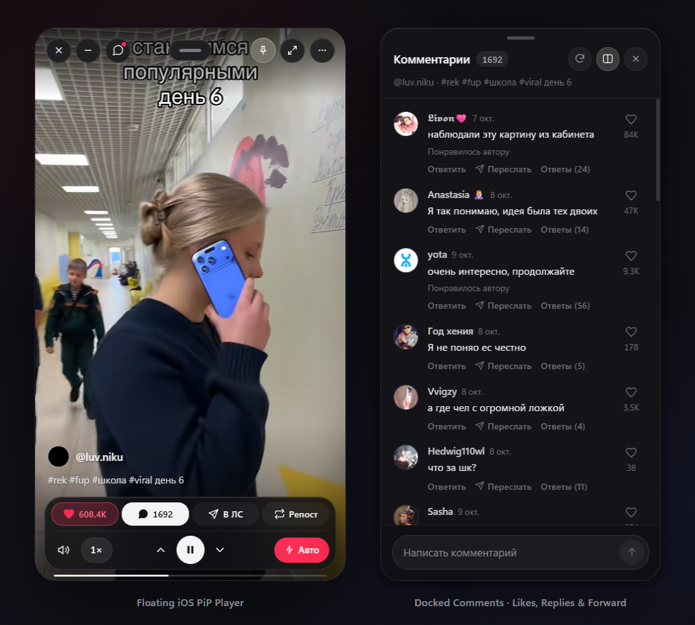
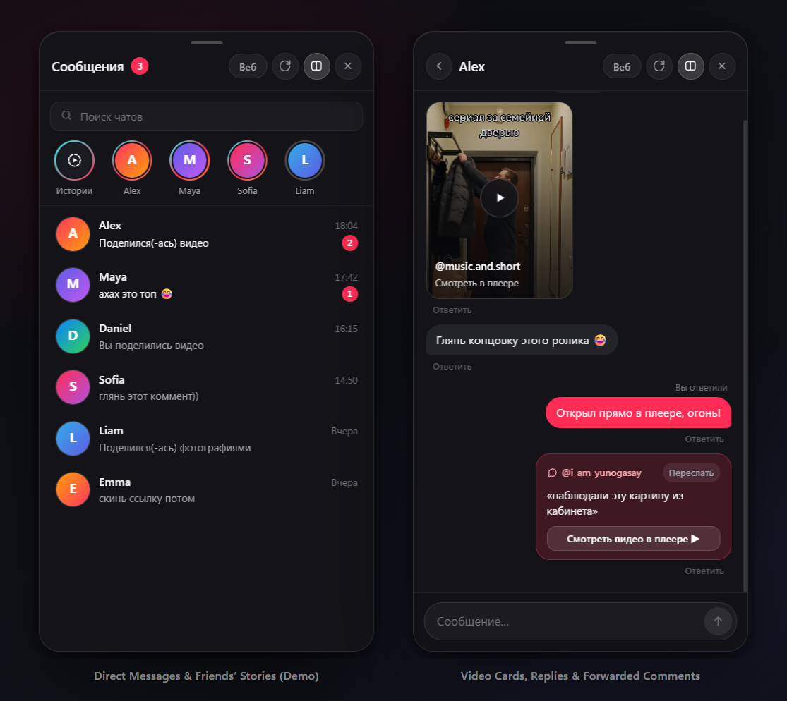
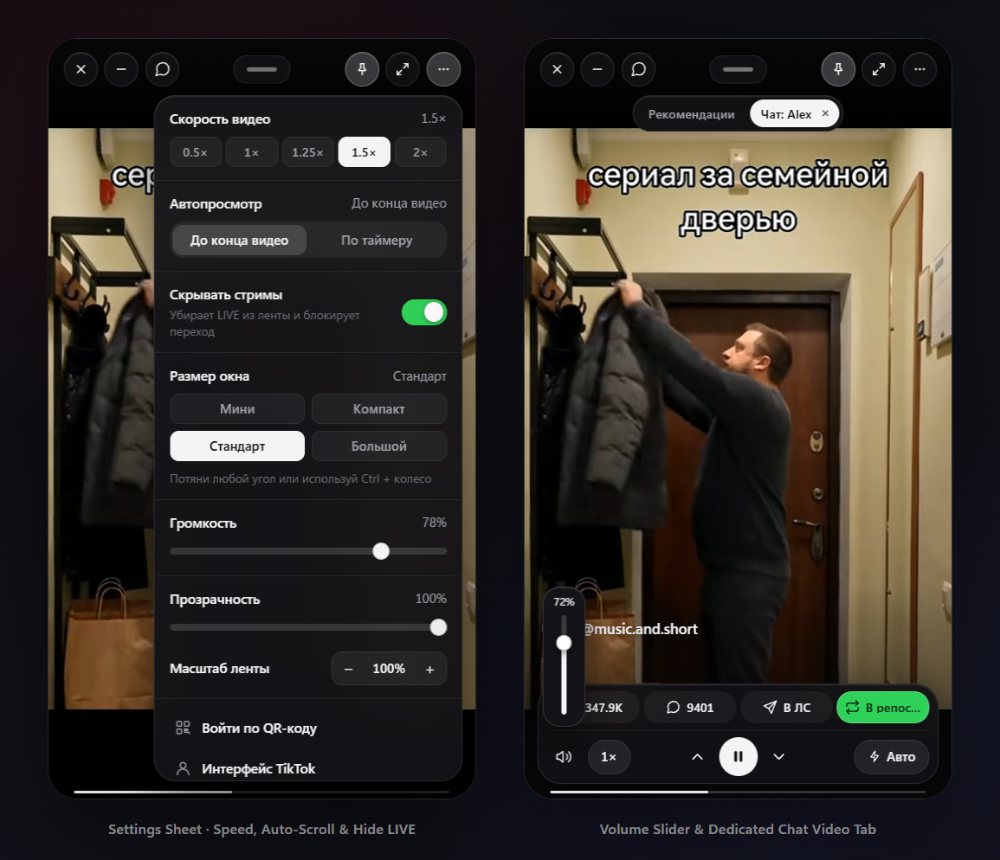

# TikTok Float

> A frameless, iOS Picture-in-Picture style floating TikTok desktop client for Windows — built with Electron, featuring always-on-top video playback, gesture controls, docked comments, native iMessage-style Direct Messages, Friends' Stories, and LIVE stream filtering.


> **Disclaimer:** This is an unofficial desktop wrapper and is not affiliated with, endorsed by, or connected to TikTok. Use at your own discretion and follow TikTok's Terms of Service.

---

## Preview

### Floating PiP Player & Docked Comments
Full-bleed video playback with TikTok's desktop chrome stripped away, replaced by an auto-hiding iOS glass HUD and a seamlessly docked Comments sheet with real-time likes, replies, media/GIF previews, and comment forwarding.



### Direct Messages, Friends' Stories & Forwarded Comments
A dedicated iMessage-inspired DM window with a Friends' Stories strip at the top, unread badges, shared TikTok video cards (clickable to open directly inside the floating player on a separate tab), native replies, and comment forwarding. *(Chat names and avatars below use anonymized demo placeholders.)*



### iOS Settings Sheet, Hide LIVE Toggle & Volume Control
Quick-access settings sheet (`···`) with playback speed (`0.5×`–`2×`), Auto-Scroll modes, the **Hide LIVE streams** switch, window size presets, floating vertical volume control, opacity, feed zoom, and one-click QR sign-in.



---

## Key Features

- **Frameless iOS Picture-in-Picture Window**
  - Always-on-top floating bezel with rounded corners and soft refraction borders.
  - Auto-hiding HUD: controls fade away cleanly when the cursor leaves the window.
  - Drag by the top iOS pill; resize smoothly from any edge or corner (aspect-ratio locked on corners, hold `Shift` for free aspect), scroll `Ctrl + Wheel`, or switch between **Mini / Compact / Standard / Large** presets.
- **Gestures & One-Click Reactions**
  - Single click to play/pause, double click to like/unlike, long-press (~0.5 s) to repost/remove repost with a circular progress ring.
  - One-click **Like**, **Comments**, **Send to DM**, and **Repost / Remove Repost** pills in the bottom HUD bar.
  - Floating vertical iOS **Volume Slider** with mouse-wheel support directly over the speaker icon.
- **LIVE Stream Protection & Filter**
  - Blocks buggy or accidental automatic redirects and SPA jumps to `/live` and `/@user/live` pages so the feed never gets hijacked.
  - **Hide LIVE streams** toggle in `···` (enabled by default): strips LIVE items directly from `/api/recommend/item_list` responses before React renders them, and instantly mutes & skips any preloaded LIVE card in your scroll direction.
- **Smart Auto-Scroll**
  - **End of video** (default): automatically advances to the next video as soon as the current clip finishes.
  - **Timer interval** (5–60 s): automatically advances on a fixed interval (also used automatically for photo posts).
- **Docked Comments Window (`C`)**
  - Separate iOS-style sheet docked beside the player (can be undocked and resized freely).
  - Strictly video-scoped: main-world `/api/comment/list` interception + per-card React Fiber `aweme_id` verification guarantees comments from a previous video never leak onto the next video when scrolling quickly.
  - Supports photos, GIFs, and stickers with full-screen lightbox preview, nested replies, accumulative infinite scroll (never wipes previously loaded comments), posting comments/replies, and forwarding any comment directly to friends.
- **Native Direct Messages & Friends' Stories (`D`)**
  - Separate iMessage-style DM window supporting both personal and TikTok Business Suite accounts, with a **Web ↔ iOS** switcher in the header.
  - **Friends' Stories** strip in the Messages header powered by TikTok's Stories API (only friends with active stories) — opens stories on a clean closeable player tab without cluttering the main feed.
  - Click any shared TikTok video card or forwarded comment in chat to watch it full-bleed inside the floating player on a dedicated **Chat** tab while preserving your exact scroll position on **For You**.
  - Send videos or forwarded comments via a native bottom **Send** sheet with recent contacts pinned at the top, multi-select, optional note, and link copying.
- **One-Click QR Code Login**
  - Sign in quickly via QR code on first launch or anytime from `···` → **QR Login**. Your session is stored locally in `%APPDATA%\TikTokFloat`.

---

## Controls & Gestures

### Video Surface Gestures

| Gesture | Action |
|---|---|
| **Single click** | Play / Pause |
| **Double click** | Like / Unlike (also 1-click on the bottom Like button) |
| **Click & hold (~0.5 s)** | Repost / Remove Repost with circular progress ring (also 1-click on the bottom Repost button) |
| **Mouse wheel** | Next / Previous video |
| **Mouse wheel over speaker icon** | Adjust volume smoothly (`±5%`) |
| **`Ctrl` + Mouse wheel** | Smoothly scale window size up / down |
| **Bottom progress bar** | Click or drag to scrub playback position |

### Keyboard Shortcuts

**Global (work from any app):**

| Shortcut | Action |
|---|---|
| `Ctrl + Alt + T` | Toggle Always-on-Top |
| `Ctrl + Alt + H` | Show / Hide player and docked panels |

**Inside the Player Window:**

| Shortcut | Action |
|---|---|
| `Space` / `K` | Play / Pause |
| `↑` / `↓` / `J` | Previous / Next video |
| `M` | Mute / Unmute |
| `C` | Toggle Comments window |
| `D` | Toggle Direct Messages window |
| `2` | Quick toggle `2×` ↔ `1×` playback speed |
| `<` / `>` | Decrease / Increase playback speed (`0.5×` – `2×`) |
| `Ctrl + +` / `Ctrl + -` | Scale window size up / down |
| `Esc` | Close active sheet or exit login/native TikTok UI mode |

---

## Getting Started

### Run Portable Executable (Windows x64)
- **Single-file portable `.exe`:** run `dist\TikTok Float.exe` (can be moved anywhere, e.g. Desktop).
- **Instant-start unpacked build:** run `dist\win-unpacked\TikTok Float.exe`.

### Run from Source

```bash
git clone https://github.com/Kovname/TikTok-Float.git
cd TikTok-Float
npm install
npm start
```

You can also launch without a console window via `TikTok Float.vbs`, or with live debug logs via `start-debug.bat`.

### Build Portable `.exe`

```bash
npm run build
```

Built binaries are output to `dist\TikTok Float.exe` and `dist\win-unpacked\TikTok Float.exe`.

---

## Project Structure

| File | Responsibility |
|---|---|
| `main.js` | Main process: frameless PiP window, docked Comments & Messages windows, LIVE URL navigation guard, state persistence, IPC, hidden DM engine lifecycle |
| `preload.js` | Secure `contextBridge` IPC API for the main player window |
| `inject.js` | Main-world TikTok page controller: clean CSS skinning, main-world API hooks (LIVE filtering & video-scoped comments), DOM fiber verification, stealth share/repost & gestures |
| `webview-preload.js` | Guest `<webview>` preload: early network tap & host message bridge |
| `index.html`, `styles.css`, `renderer.js` | Floating iOS-style PiP player shell, HUD, settings sheet, volume popover, and share sheet |
| `comments.html`, `comments.css`, `comments.js`, `comments-preload.js` | Dockable iOS Comments window with media lightbox & comment forwarding |
| `messages.html`, `messages.css`, `messages.js`, `messages-preload.js` | Dockable iMessage-style Direct Messages window & Friends' Stories strip |
| `dm-engine.js`, `dm-engine-preload.js` | Background TikTok DM & Stories scraper/sender supporting multi-frame `/messages` and Business Suite |
| `docs/screenshots/` | Showcase screenshots used in this README |

---

## License

[MIT](package.json)
